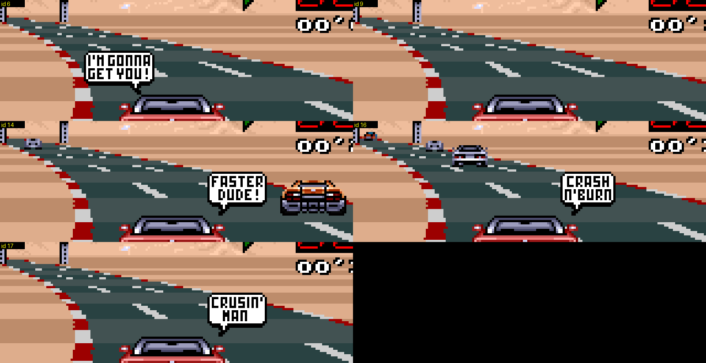

# Race messages and speech balloons (original game)

Two kinds of pop-ups appear over each player's view during a race. Both go through the same state machine in `update_hud_counters` (`00:DA75`) and are written to the BG1 tilemap with `hud_draw_string_p1/p2` (`00:DD9C/DDC0`, string table `06:DF16`, 130 entries). Found by reading the disassembly and confirmed in Mesen by forcing the state variables and by playing (scripts were throwaway; the tables below are read straight from the ROM).

* **Text messages** (white pixel font, they blink): rank change (`13TH`), laps left, `FUEL LOW`, `OUT OF FUEL`, countdown, `RACE OVER`, pit arrow.
* **Speech balloons** (white bubble with a tail and a comic-style comment): the ones you notice when overtaking, bumping or lapping.

## State variables

| | P1 | P2 / computer car | meaning |
|---|---|---|---|
| `$0118` / `$012A` | | | **balloon request**, 0 = none. Written by the game logic, consumed by the HUD code (`00:DB75` / `DD07`) and cleared. Message index = id + `$1E` (P1) or id + `$5D` (P2). |
| `$0124` / `$0136` | | | current message index (string number in `06:DF16`), `$FFFF` = none |
| `$0126` / `$0138` | | | blink/phase counter of the message (6-frame blink period) |
| `$0128` / `$013A` | | | flags copied from the `06:DB80[index]` table: `$8000` blink, `$4000` / `$C000` stays until replaced |
| `$0120` / `$0132` | | | pointer into a graphics stream (`06:DC84[index]`): `pit_sign_dma` (`00:D86A`) copies 64 bytes (2 tiles) per frame to VRAM (`$0122` / `$0134`, +`$20` words each step) until a 0 terminator, so the text or balloon artwork is "typed in" over a few frames before the tilemap is shown |
| `$011A` / `$012C` | | | last rank shown |
| `$011E` / `$0130` | | | last lap count shown |
| `$011C` / `$012E` | | | fuel warning state |
| `$1EFB` / `$1EFC` | | | **collision heat** (byte): +`$30` per car contact, -1 per frame |
| `$1EF5` bit1 / `$1EF6` bit1 | | | "already taunted for this lapping" latch |

Message index map (P1; P2 is the same list at +`$3F`, so P2 ranks start at 63):

| index | text | trigger |
|---|---|---|
| 0..19 | rank `1ST`..`20TH` | `$1E7A` (rank, 0-based) differs from the last shown one |
| 20 | `FINAL LAP` | lap counter changes, `laps_total - 1 - done = 0` |
| 21..28 | `2 LAPS LEFT` .. `9 LAPS LEFT` | same, index = 20 + laps remaining after the current one |
| 29 | `FUEL LOW` | fuel `$1E62 < $3000` (once; re-armed when fuel is back above `$3000`) |
| 30 | `OUT OF FUEL` | fuel = 0 (stays) |
| 31..34 | `3`, `2`, `1`, `GO!` | start countdown: `$0118` = 1..4 at `00:868A` |
| 35 | `RACE OVER` | the car has finished: `$0118` = 5 at `00:8790` (stays; final rank string follows) |
| 36..54 | speech balloons, id 6..24 | see below |
| 55..62 | wide text strips (4000 flag, shared graphics stream `050E`) | no writer found in the logic; probably unused leftovers |
| 126 / 127 | pit arrow (left / right, from the sign side flag `$DF`) | the car is within `$1000` units before the pit lane entrance (`$1EF0`) |

When a lap is completed and the race is not over, the lap message is queued instead of the rank message; rank, fuel and pit messages are only checked when no other message is on screen (`$0128 = 0`).

## Speech balloon ids

Verified by forcing `$0118` in a race (index = id + 30):

| id | text | id | text |
|---|---|---|---|
| 6 | I'M GONNA GET YOU! | 16 | CRASH N' BURN |
| 7 | YO! BURN RUBBER | 17 | CRUSIN' MAN |
| 8 | OUTTA MY WAY!! | 18 | LATER GEEK! |
| 9 | (empty graphics) | 19 | YO BONE HEAD!! |
| 10 | MOVE THE WRECK! | 20 | HA! HA! LOSER |
| 11 | ARE YOU BLIND? | 21 | WATCH OUT! |
| 12 | WHAT THE HECK?? | 22 | AAARGH |
| 13 | EAT DUST SUCKER! | 23 | OUCH |
| 14 | FASTER DUDE! | 24 | &*#@!! (cursing) |
| 15 | LET'S GO! | | |

Ids 6, 9, 14, 16 and 17 are never produced by any trigger below. They are leftover content: 6, 14, 16 and 17 are complete, normal-looking bubbles (`I'M GONNA GET YOU!`, `FASTER DUDE!`, `CRASH N'BURN`, `CRUSIN' MAN`), id 9 shows nothing at all (its tilemap is drawn but no bubble artwork appeared at any point of its display window; the graphics stream `06:DE1A` was not inspected).

Each bubble appears at a fixed spot in the player's view (upper middle, above the car); the cars next to it in the picture are just bots passing by. The picture is a 4x nearest-neighbour crop of in-game frames (order: 6, 9 / 14, 16 / 17).

## What triggers a balloon

All triggers write the id into `$0118` (P1) or `$012A` (P2 / computer car). The balloon is always the *car's own* comment, shown in that player's view. P2 uses the mirrored code (`05:E6xx/E7xx`, `05:DBF6`) with the P2 variables; in a 1-player race the "P2" side is the computer car and its balloons are never drawn.

1. **Nitro** (`05:D379`, P2: `05:DBF6`): pressing the nitro button with a charge left and speed `$1E5A >= $1900` (150 km/h) says id **15** `LET'S GO!` (always, no dice).
2. **Passing a car at a big speed advantage** (`05:E3D6`..`E5A4`; P2 `05:E6xx`..`E789`): each game tick the code looks at the nearest car ahead in the list. When the player's position reaches it (within 7 units) and the player is faster, and the speed difference `player - car*2` exceeds `$1E00` (7680 = 180 km/h), a random number `X = rng >> 4` (0..15) picks the comment from a table, so each qualifying event has a 4/16 chance of a balloon (the other 12 entries are 0):
   * lateral gap within the hit window (an actual **collision**): `00:E1CE[X]`, only X = 12..15 give a balloon: ids **8, 10, 11, 24** (`OUTTA MY WAY!!`, `MOVE THE WRECK!`, `ARE YOU BLIND?`, `&*#@!!`).
   * lateral gap larger than the window (a **near miss**, the car goes past beside you): `00:E1CA[X]`, X = 0..3: ids **7, 13, 20, 18** (`YO! BURN RUBBER`, `EAT DUST SUCKER!`, `HA! HA! LOSER`, `LATER GEEK!`).
   Because `X` comes from the shared LCG every event also advances the random sequence (see docs/03 RNG notes).
3. **Several collisions in a row** (`00:B33B` `bots_event_counters`, called every tick from `00:8770`): every collision of case 2 adds `$30` to the heat byte `$1EFB` (P1) / `$1EFC` (P2), whether or not it gave a balloon; the byte decays by 1 per tick. When it reaches `>= $50` (two contacts within about 16 ticks) it is cleared and a balloon is drawn from `00:E1ED[X]`: ids **10, 11, 22, 12, 8** (X = 5 gives nothing), i.e. `MOVE THE WRECK!`, `ARE YOU BLIND?`, `AAARGH`, `WHAT THE HECK??`, `OUTTA MY WAY!!`.
4. **Hitting a roadside object hard** (`05:F6B3`, objects of class REV, see docs/03): when speed `>= $1770` (about 140 km/h) at impact, `00:E1DE[X]` gives ids **22, 23, 24, 21** for X = 0..3 (`AAARGH`, `OUCH`, `&*#@!!`, `WATCH OUT!`), and id 10 for X = 15. Same 4/16 chance.
5. **Lapping the other player** (`00:B33B`): the lap counters of both players are compared (`$1E76 - $1E78`, both incremented first so the "before the start line" value `$FFFF` counts as 0). If player 1 is ahead by 2 or more laps, or by exactly 1 lap *and* is also ahead on the road (`$0204 >= $0206`, slot offsets in the car list), the leader gets id **19** `YO BONE HEAD!!` once (latched in bit1 of `$1EF5`; the latch is cleared when the other player is in front or the lap counts are equal, so it re-arms after the lapped player gets back to the same lap). Player 2 gets the same through `$1EF6` / `$012A`. In a 1-player race `$1E78` is the computer car's lap count, so the human gets the taunt when lapping the computer car and the computer's balloon is hidden.

Not found: no balloon is tied to being bumped from behind by a bot (`00:A30C`) or to leaving the road; those only set the crash-sound flag.

## Notes for the randomizer

Nothing in the hack touches these tables or the state machine. The messages are drawn on BG1 tilemap rows 4-8 (P1, strings at `$0C8B`..`$0D12`) and rows 18-22 (P2, `$0E4E`..`$0ED2`), mostly in columns 11-21. The lap counters sit on rows 5 and 19 from column 21 (right aligned to column 29), so only the widest messages can touch the first counter cell; not checked in the GUI.
