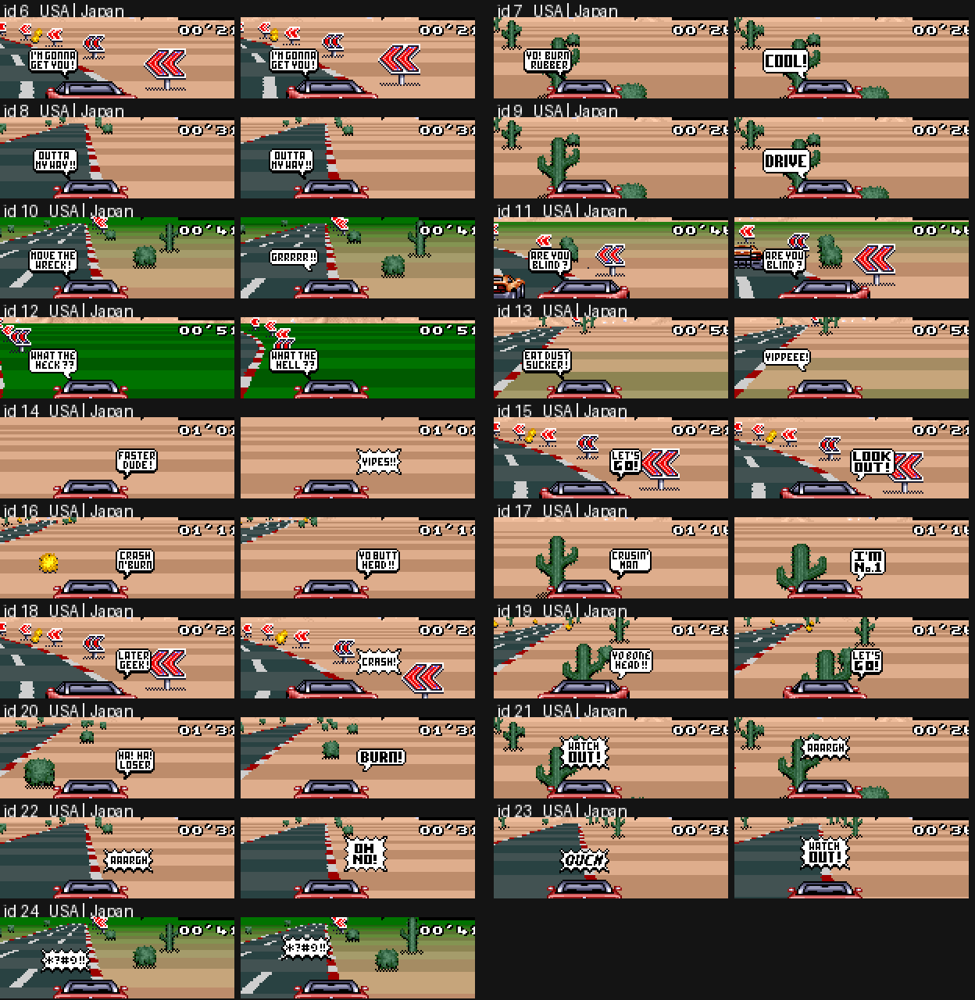

# The three releases: Top Gear (USA), Top Gear (Europe), Top Racer (Japan)

All three are 512 KB LoROM images with the same layout, the same engine and the same car / track / music data. The differences are small and
fall into two families: **Europe = USA + a 50 Hz timing patch**, **Japan = USA before the localisation** (different title, balloon texts,
two passwords, no anti-skip on the title). Everything below was found by byte-diffing the ROMs, disassembling each one with its own runtime
trace (`tools/disasm.py` + `tools/asmdiff.py`) and checking the conclusions in the emulator (`scripts/ver_*.lua`).

| | USA | Europe | Japan |
|---|---|---|---|
| header title / country byte (`$7FD9`) / maker (`$7FDA`) | `TOP GEAR` / `01` / `7F` | `TOP GEAR` / `02` / `7F` | `TOP RACER` / `00` / `C2` |
| 16-bit checksum (`$7FDE`) | `C15C` | `45BD` | `B79C` |
| code identical to USA (modulo relocation) | - | yes, except the 3 patches below | yes, except §Japan |
| frame rate | 60 Hz | 50 Hz, game clock kept at 60 units/s | 60 Hz |

Raw diff statistics: USA vs Europe 45 371 bytes differ, USA vs Japan about 118 000. Almost all of that is noise:
* **Bank tails are uninitialised padding.** The unused end of every 32 KB bank (and 0D:C9C2.., 0C:E962.., the first 0x2A0..0x400 bytes of banks 9..C) holds
  random leftover bits in each build (mostly `FF`/`00` with a few stray bits). Never compare there.
* **Relocation.** Europe inserts 21 + 22 bytes in bank 00 (see below), so every bank-00 address after `00:B6DC` moves by +21 / +43 and every
  pointer to it changes (`LDA $E1CE,X` -> `$E1F9,X`; 05:E50D, E59C, E6EC, E77B, F1E6, F6CE, F744, 0F:A8xx ...). Japan has +5 in bank 00 after 00:B751
  and +38 in bank 0D from about `0D:C150` (menu tilemaps and strings), -8 in bank 0F after `0F:8F2D`.
* **Compressed streams.** Graphics and the 5 KB engine image are compressed, so one changed tile rewrites the rest of its stream.
  The WRAM engine image decompressed at boot (`7E2000-7E34FF`) is **byte-identical in USA and Europe**; the code in it is the same in Japan
  (same instruction sequence, different pointer values).
* Immediates inside `7E2xxx..7E3xxx` differ between dumps taken during a race (e.g. `LDA #$1B` vs `#$05` at 7E:26DF): they are self-modified at run time, not ROM differences.

## Europe (PAL, 50 Hz)

### The patch (3 places, all in bank 00)

The engine has two time bases, both advanced by the per-frame job `irq_vblank_start` (00:B6D1, started by the V-IRQ at line 224; the same line is the first
vblank line on PAL, so the IRQ/HDMA set-up needed no change):

| counter | meaning | users |
|---|---|---|
| `$0C` | "frames elapsed" | `wait_frames` (00:EC0E), and `$1E90 = $0C + 1` = the tick length delta that scales distance, RPM ramps, speed-chase ... |
| `$1EAE` | race clock (`race_frames`) | lap/race timer, day/night script, finish time |

Europe makes both of them count **6 units per 5 frames** (= 60 units/s at 50 frames/s), so everything that is expressed in game time keeps its NTSC pace:

```
00:B6DC (right after INC $0C)          00:B963 (right after INC $1EAE)
  SEP #$20                               SEP #$20
  LDA $18 / INC A / CMP #$05             LDA $19 / INC A / CMP #$05
  BNE +                                  BNE +
  STZ $18 ; REP #$20 ; INC $0C ; BRA ++  STZ $19 ; REP #$20 ; INC $1EAE ; BRA ++
+ STA $18 ; REP #$20                   + STA $19 ; REP #$20
++                                     ++
00:EC17 (wait_frames spin)   BNE $EC15  ->  BMI $EC15   (counter can now jump over 0)
```
`$18`/`$19` start as `$02/$02` (set by `LDA #$0202 / STA $18` at 00:81D0) and are used for nothing else in USA. (In Japan they are `$8F/$00`, and `$19` is written to the mosaic register `$2106` every frame, see below; the USA build dropped that write, Europe reused the byte.)

Nothing else in the code changed: no VBlank-length, IRQ line, SETINI (`$2133 = 0`, 224 lines) or music-tempo change. The 15 extra scanlines of PAL
are simply blank, and the V-IRQ at 224 splits the screen exactly as on NTSC.

### What the patch does *not* cover (everything still counted in raw frames)
The main loop is CPU bound (~50 ms per tick, 20 ticks/s on both systems: USA 2.99 frames/tick, Europe 2.49 frames/tick = same time),
so physics ticks, fuel burn, speed-chase and everything scaled by `$1E90` behave like USA. Things advanced **once per frame** do not:

| per-frame thing | USA | Europe |
|---|---|---|
| **nitro** (00:B9ED state machine in the per-frame job, 320 frames, docs/02) | 5.33 s | **6.40 s** (384 game-time units; measured with `scripts/ver_nitro.lua`: 320 frames on both ROMs, `$1EAE` +320 vs +384) |
| **pit refuel** (`00:9172`: `fuel += $7F` per loop pass, one pass per frame, ~339 passes, docs/04) | ~5.7 s | ~6.8 s (code reasoning, not timed) |
| screen-flash / fade steps (`$E1`, `$E2`, `$52`, `$65`) | 16.7 ms per step | 20 ms per step |
| curve scroll accumulation (`$1E96 += $1E9A` -> `$B0`, `$1E98 += $1E9C` -> `$C4`, once per frame, 00:B9B7) | 60 steps/s | 50 steps/s (not measured) |
| anything waiting in `wait_frames` | n units | n units (compensated, same real time) |

### Fuel
Measured with `scripts/ver_fuel.lua` (hook on the burn code 05:D638, full throttle, about 1200 physics ticks per ROM, same input script):

| | USA | Europe |
|---|---|---|
| burn per physics tick | 20.69 | 20.52 |
| frames per tick | 2.99 | 2.49 |
| game-time units (`$1E90`) per tick | 2.978 | 2.977 |
| fuel per game-time unit (1/60 s) | 6.947 | 6.891 |
| fuel per distance (`burn / sum(speed*delta)` x 1000) | 2.0851 | 2.0824 |

So with identical driving the tank empties at the same rate per real second and per distance; the difference is below 1 %, inside the noise of two
different race histories. The burn code is byte-identical, the burn is per tick, and the tick rate in real time is the same. **I could not
reproduce a "less fuel" effect in steady driving.** What does differ on Europe, and could be what the community feels:
* nitro lasts 20 % longer (more time at the high nitro top speed for the same one charge; fuel burn per distance is about the same, so that reads as "the same fuel
  takes me further" on nitro stretches);
* a pit stop is ~1.1 s longer, so a strategy that needs fewer stops looks better;
* anything that depends on the frame/tick quantisation of `$1E90` (3 units vs the 2/3-frame mix).
If there is a concrete claim (which car, which track, how many laps per tank) it can be tested directly with the `ver_fuel` hook.

### Text, graphics, palette (Europe)
* Spelling: `TIRE GRIP` -> **`TYRE GRIP`** (car select strings, 0F:A8A3 `49 -> 59`). The USA font had no `Y` glyph in that font, so the glyph was added: the 4bpp tiles in bank 02 (02:DD4C..DE38, E1ED..E2B8, E309.., EC4D..ED6E) and the recompressed font stream in bank 09 (09:D642..E573) differ.
* One 16-byte palette in bank 0E (0E:FBD6) differs; not yet identified on which screen.
* Everything else (title, menus, countries, passwords, balloons, results) is identical to USA. Title screens compare equal frame by frame.

## Japan (Top Racer)

### Same as USA
Car stats and every physics table (`00:9597/960B/967F/96F3/97DB`, byte-identical at the same addresses), the physics / AI / collision code (bank 05
differs in 2 immediates + 8 relocated pointers), track descriptors and data (bank 0C), minimaps, music/SPC data (bank 07), sprite renderer (bank 01).
Gameplay physics, fuel burn, nitro length (320 frames, tested) and the 32 tracks are the same as in USA.

### Differences
1. **Title:** `TOP RACER` with **three** stars (USA/EUR: `TOP GEAR`, two stars), and no `LICENSED BY NINTENDO` line. The logo animation loop counts differ
   (`LDY #$0100`, `LDX #$0036` instead of `#$00E0`, `#$0045` at 0F:8ED0..8EDC). Ending text `ON COMPLETING TOP RACER`.
2. **No anti-skip on the title.** USA/EUR (0F:8F2D): `LDA $1FF6 / CMP #$03E8 / BCS` ignores Start during the first 200 frames of the 1200 frame demo countdown
   (`$1FF6` counts down from `$04B0`); Japan accepts it immediately (the 8 bytes are not there).
3. **Mosaic:** Japan's per-frame job writes `LDA $19 / STA $2106` (00:B751); `$19` is never set in the code, so it is permanently 0 (mosaic off). Leftover of a transition effect that USA removed (the USA init `LDA #$0202 / STA $18` sets `$19 = 2`, harmless without the store).
4. **Speech balloons are different** (see the table). The engine is the same; the 19 ids (6..24 -> `$0118`) show other bubbles and the four random tables
   (`00:E1CA` near miss, `E1CE` collision, `E1DE` roadside object, `E1ED` repeated collisions) pick other ids, plus two immediates:
   nitro start `LDA #$000F` -> `#$0013` (05:D376, DBF3, still `LET'S GO!`) and lapping the other player `LDA #$0013` -> `#$0010` (00:B369, B392).
5. **Passwords** (`0D:C513` table, which is only *shown*, never asked for): word 9 `LEGEND` -> **`LEDGEND`** (typo, the professional country 2 password) and the last one
   (championship, last country) `KEELSON` -> **`VALHALLA`**. The other 19 are equal.
6. **Strings:** `TYRE GRIP` (not `TIRE`), as Europe. Credits, `= 8 PTS` tables, track names unchanged.
7. Graphics / tilemaps in banks 02..04, 0D (menu tilemaps, 0D:AEAF..C7F9) and 0E (title logo tiles) are different (new logo, new font cells);
   bank 0F (menus) is the USA code shifted by -8 bytes after 0F:8F2D plus pointer changes.

### Balloon ids (Japan vs USA)


| id | USA | Japan | | id | USA | Japan |
|---|---|---|---|---|---|---|
| 6 | I'M GONNA GET YOU! | same | | 16 | CRASH N' BURN | YO BUTT HEAD!! |
| 7 | YO! BURN RUBBER | COOL! | | 17 | CRUSIN' MAN | I'M No.1 |
| 8 | OUTTA MY WAY!! | same | | 18 | LATER GEEK! | CRASH! |
| 9 | (nothing) | DRIVE | | 19 | YO BONE HEAD!! | LET'S GO! |
| 10 | MOVE THE WRECK! | GRRRRR!! | | 20 | HA! HA! LOSER | BURN!! |
| 11 | ARE YOU BLIND? | same | | 21 | WATCH OUT! | AAARGH |
| 12 | WHAT THE HECK?? | WHAT THE HELL?? | | 22 | AAARGH | OH NO! |
| 13 | EAT DUST SUCKER! | YIPPEEE! | | 23 | OUCH | WATCH OUT! |
| 14 | FASTER DUDE! | YIPES!! | | 24 | `&*#@!!` | same |
| 15 | LET'S GO! | LOOK OUT! | | | | |

Which ids the game draws (docs/11 lists the USA triggers):

| trigger | USA ids | Japan ids |
|---|---|---|
| nitro pressed above 150 km/h | 15 LET'S GO! | 19 LET'S GO! |
| lapping the other player | 19 YO BONE HEAD!! | 16 YO BUTT HEAD!! |
| near miss at +180 km/h (`E1CA`, X = 0..3) | 7, 13, 20, 18 | 7 COOL!, 17 I'M No.1, 13 YIPPEEE!, 20 BURN!! |
| collision at +180 km/h (`E1CE`, X = 12..15) | 8, 10, 11, 24 | 10 GRRRRR!!, 11 ARE YOU BLIND?, 14 YIPES!!, 24 |
| roadside object >= 140 km/h (`E1DE`, X = 0..3 (4 in Japan), 15) | 22, 23, 24, 21 / 10 | 21, 14, 23, 22, 15 / 8 |
| two quick collisions (`E1ED`, X = 0..4 repeated) | 10, 11, 22, 12, 8 | 8, 6, 11, 24, 12 |

Unused ids: USA 6, 9, 14, 16, 17 (docs/11); Japan 9 (`DRIVE`) and 18 (`CRASH!`). The Japanese set is "friendlier" (the USA insults `EAT DUST SUCKER!`, `HA! HA! LOSER`, `LATER GEEK!` are gone) and matches the event better (`YIPPEEE!`
after a pass, `OH NO!` / `CRASH!` after a hit).

## How this was done / reproduce
1. `python3 -I tools/romcmp.py "Top Gear (USA).sfc" "Top Gear (Europe).sfc"`: header fields, 4 KB similarity map, differing regions (mind the padding and relocation noise described at the top).
2. For each ROM: `TG_ROM=<rom> tools/mesen.sh scripts/trace.lua` (coverage trace, `out/trace_main.txt` equivalent), `scripts/dumpram.lua` (WRAM at frame 3300), then
   `python3 -I tools/disasm.py ROM out.asm --seeds trace --wram wram_3300.bin`.
3. `python3 -I tools/asmdiff.py usa.asm eur.asm` lists only the real changes (jump targets and 16-bit operands are masked; `--all` shows relocations too).
   USA vs Europe prints exactly the three patches above; USA vs Japan prints the list in §Japan.
4. Emulator checks: `scripts/ver_nitro.lua`, `scripts/ver_fuel.lua`, `scripts/ver_balloons.lua` (all take `TG_ROM`).
