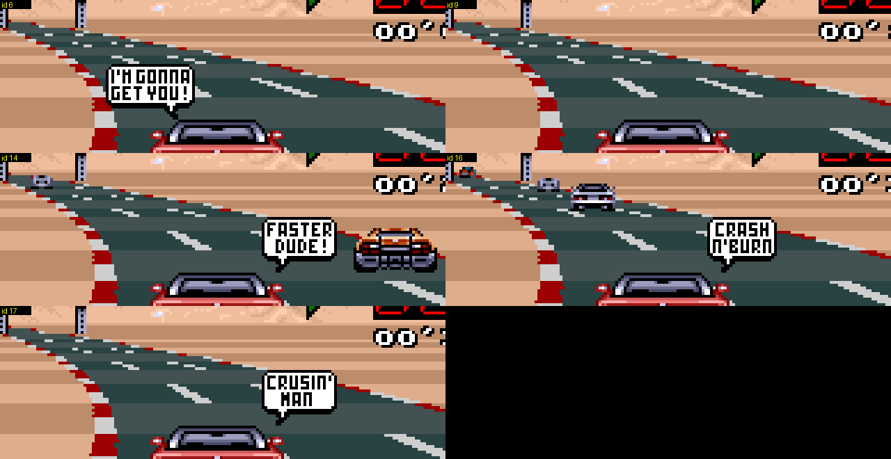

# Mensajes de carrera y globos de diálogo (juego original)

Dos tipos de ventanas emergentes aparecen sobre la vista de cada jugador durante la carrera. Ambas pasan por la misma máquina de estados en `update_hud_counters` (`00:DA75`) y se escriben en el tilemap del BG1 con `hud_draw_string_p1/p2` (`00:DD9C/DDC0`, tabla de cadenas `06:DF16`, 130 entradas). Descubierto leyendo el desensamblado y confirmado en Mesen forzando las variables de estado y jugando (los scripts fueron desechables; las tablas siguientes se leen directamente de la ROM).

* **Mensajes de texto** (fuente de píxeles blanca, parpadean): cambio de posición (`13TH`), vueltas restantes, `FUEL LOW`, `OUT OF FUEL`, cuenta atrás, `RACE OVER`, flecha del pit.
* **Globos de diálogo** (globo blanco con cola y comentario estilo cómic): los que notas al adelantar, chocar o doblar a alguien.

## Variables de estado

| | P1 | P2 / coche del ordenador | significado |
|---|---|---|---|
| `$0118` / `$012A` | | | **petición de globo**, 0 = ninguna. Escrita por la lógica del juego, consumida por el código del HUD (`00:DB75` / `DD07`) y puesta a cero. Índice del mensaje = id + `$1E` (P1) o id + `$5D` (P2). |
| `$0124` / `$0136` | | | índice del mensaje actual (número de cadena en `06:DF16`), `$FFFF` = ninguno |
| `$0126` / `$0138` | | | contador de parpadeo/fase del mensaje (periodo de 6 frames) |
| `$0128` / `$013A` | | | flags copiadas de la tabla `06:DB80[index]`: `$8000` parpadea, `$4000` / `$C000` se queda hasta que lo sustituyan |
| `$0120` / `$0132` | | | puntero a un stream de gráficos (`06:DC84[index]`): `pit_sign_dma` (`00:D86A`) copia 64 bytes (2 tiles) por frame a la VRAM (`$0122` / `$0134`, +`$20` palabras en cada paso) hasta un terminador 0, de modo que el texto o el arte del globo se "teclea" durante unos frames antes de mostrarse el tilemap |
| `$011A` / `$012C` | | | última posición mostrada |
| `$011E` / `$0130` | | | última cuenta de vueltas mostrada |
| `$011C` / `$012E` | | | estado del aviso de combustible |
| `$1EFB` / `$1EFC` | | | **calor de colisión** (byte): +`$30` por contacto entre coches, -1 por frame |
| `$1EF5` bit1 / `$1EF6` bit1 | | | cerrojo "ya provocó por este doblaje" |

Mapa de índices de mensaje (P1; P2 es la misma lista en +`$3F`, así que las posiciones de P2 empiezan en 63):

| índice | texto | disparador |
|---|---|---|
| 0..19 | posición `1ST`..`20TH` | `$1E7A` (posición, base 0) difiere de la última mostrada |
| 20 | `FINAL LAP` | el contador de vueltas cambia, `laps_total - 1 - done = 0` |
| 21..28 | `2 LAPS LEFT` .. `9 LAPS LEFT` | igual, índice = 20 + vueltas restantes después de la actual |
| 29 | `FUEL LOW` | combustible `$1E62 < $3000` (una vez; se rearma cuando el combustible vuelve por encima de `$3000`) |
| 30 | `OUT OF FUEL` | combustible = 0 (permanece) |
| 31..34 | `3`, `2`, `1`, `GO!` | cuenta atrás de la salida: `$0118` = 1..4 en `00:868A` |
| 35 | `RACE OVER` | el coche ha terminado: `$0118` = 5 en `00:8790` (permanece; la cadena de la posición final viene después) |
| 36..54 | globos de diálogo, id 6..24 | ver abajo |
| 55..62 | franjas anchas de texto (bandera 4000, stream de gráficos compartido `050E`) | no se encontró escritor en la lógica; probablemente sobras sin uso |
| 126 / 127 | flecha del pit (izquierda / derecha, de la flag de lado de la señal `$DF`) | el coche está a menos de `$1000` unidades antes de la entrada de la calle de boxes (`$1EF0`) |

Cuando se completa una vuelta y la carrera no ha terminado, el mensaje de la vuelta se encola en lugar del mensaje de posición; posición, combustible y pit solo se comprueban cuando no hay otro mensaje en pantalla (`$0128 = 0`).

## Ids de los globos de diálogo

Verificado forzando `$0118` en una carrera (índice = id + 30):

| id | texto | id | texto |
|---|---|---|---|
| 6 | I'M GONNA GET YOU! | 16 | CRASH N' BURN |
| 7 | YO! BURN RUBBER | 17 | CRUSIN' MAN |
| 8 | OUTTA MY WAY!! | 18 | LATER GEEK! |
| 9 | (gráficos vacíos) | 19 | YO BONE HEAD!! |
| 10 | MOVE THE WRECK! | 20 | HA! HA! LOSER |
| 11 | ARE YOU BLIND? | 21 | WATCH OUT! |
| 12 | WHAT THE HECK?? | 22 | AAARGH |
| 13 | EAT DUST SUCKER! | 23 | OUCH |
| 14 | FASTER DUDE! | 24 | &*#@!! (improperio) |
| 15 | LET'S GO! | | |

Los ids 6, 9, 14, 16 y 17 nunca son producidos por ninguno de los disparadores siguientes. Son contenido sobrante: 6, 14, 16 y 17 son globos completos de aspecto normal (`I'M GONNA GET YOU!`, `FASTER DUDE!`, `CRASH N'BURN`, `CRUSIN' MAN`), y el id 9 no muestra nada (su tilemap se dibuja, pero no apareció arte de globo en ningún momento de su ventana de visualización; el stream de gráficos `06:DE1A` no se inspeccionó).

Cada globo aparece en un punto fijo de la vista del jugador (parte superior central, encima del coche); los coches junto a él en la imagen son solo bots que pasan. La imagen es un recorte 4x por vecino más cercano de frames del juego (orden: 6, 9 / 14, 16 / 17).

## Qué dispara un globo

Todos los disparadores escriben el id en `$0118` (P1) o `$012A` (P2 / coche del ordenador). El globo es siempre el comentario del *propio coche*, mostrado en la vista de ese jugador. El P2 usa el código reflejado (`05:E6xx/E7xx`, `05:DBF6`) con las variables del P2; en una carrera de 1 jugador el lado "P2" es el coche del ordenador y sus globos nunca se dibujan.

1. **Nitro** (`05:D379`, P2: `05:DBF6`): pulsar el botón de nitro con una carga disponible y velocidad `$1E5A >= $1900` (150 km/h) dice el id **15** `LET'S GO!` (siempre, sin dado).
2. **Adelantar a un coche con gran ventaja de velocidad** (`05:E3D6`..`E5A4`; P2 `05:E6xx`..`E789`): en cada tick el código mira el coche más cercano por delante en la lista. Cuando la posición del jugador lo alcanza (a menos de 7 unidades) y el jugador es más rápido, y la diferencia de velocidad `player - car*2` excede `$1E00` (7680 = 180 km/h), un número aleatorio `X = rng >> 4` (0..15) elige el comentario de una tabla, así que cada evento que cumple tiene 4/16 de probabilidad de globo (las otras 12 entradas son 0):
   * distancia lateral dentro de la ventana de impacto (una **colisión** de verdad): `00:E1CE[X]`, solo X = 12..15 dan globo: ids **8, 10, 11, 24** (`OUTTA MY WAY!!`, `MOVE THE WRECK!`, `ARE YOU BLIND?`, `&*#@!!`).
   * distancia lateral mayor que la ventana (un **roce cercano**, el coche pasa a tu lado): `00:E1CA[X]`, X = 0..3: ids **7, 13, 20, 18** (`YO! BURN RUBBER`, `EAT DUST SUCKER!`, `HA! HA! LOSER`, `LATER GEEK!`).
   Como `X` sale del LCG compartido, cada evento también avanza la secuencia aleatoria (ver las notas de RNG en docs/03).
3. **Varias colisiones seguidas** (`00:B33B` `bots_event_counters`, llamado en cada tick desde `00:8770`): toda colisión del caso 2 suma `$30` al byte de calor `$1EFB` (P1) / `$1EFC` (P2), haya dado globo o no; el byte decae 1 por tick. Cuando llega a `>= $50` (dos contactos en unos 16 ticks) se pone a cero y se sortea un globo de `00:E1ED[X]`: ids **10, 11, 22, 12, 8** (X = 5 no da nada), es decir `MOVE THE WRECK!`, `ARE YOU BLIND?`, `AAARGH`, `WHAT THE HECK??`, `OUTTA MY WAY!!`.
4. **Golpear fuerte un objeto lateral** (`05:F6B3`, objetos de la clase REV, ver docs/03): cuando la velocidad `>= $1770` (unos 140 km/h) en el impacto, `00:E1DE[X]` da los ids **22, 23, 24, 21** para X = 0..3 (`AAARGH`, `OUCH`, `&*#@!!`, `WATCH OUT!`), y el id 10 para X = 15. Misma probabilidad de 4/16.
5. **Doblar al otro jugador** (`00:B33B`): se comparan los contadores de vueltas de ambos jugadores (`$1E76 - $1E78`, ambos incrementados antes para que el valor "antes de la línea de salida" `$FFFF` cuente como 0). Si el jugador 1 va por delante por 2 o más vueltas, o por exactamente 1 vuelta *y* también va por delante en la carretera (`$0204 >= $0206`, desplazamientos de slot en la lista de coches), el líder recibe el id **19** `YO BONE HEAD!!` una vez (cerrojo en el bit1 de `$1EF5`; el cerrojo se libera cuando el otro jugador va delante o las vueltas son iguales, así que se rearma después de que el jugador doblado vuelva a la misma vuelta). El jugador 2 recibe lo mismo mediante `$1EF6` / `$012A`. En una carrera de 1 jugador `$1E78` es la cuenta de vueltas del coche del ordenador, así que el humano recibe la provocación al doblar al ordenador y el globo del ordenador queda oculto.

No encontrado: ningún globo está ligado a ser golpeado por detrás por un bot (`00:A30C`) ni a salirse de la carretera; eso solo activa la flag del sonido de choque.

## Notas para el randomizer

Nada en el hack toca estas tablas ni la máquina de estados. Los mensajes se dibujan en las filas 4-8 del tilemap del BG1 (P1, cadenas en `$0C8B`..`$0D12`) y en las filas 18-22 (P2, `$0E4E`..`$0ED2`), sobre todo en las columnas 11-21. Los contadores de vueltas están en las filas 5 y 19 desde la columna 21 (alineados a la derecha en la columna 29), así que solo los mensajes más anchos pueden tocar la primera celda del contador; no comprobado en la GUI.
