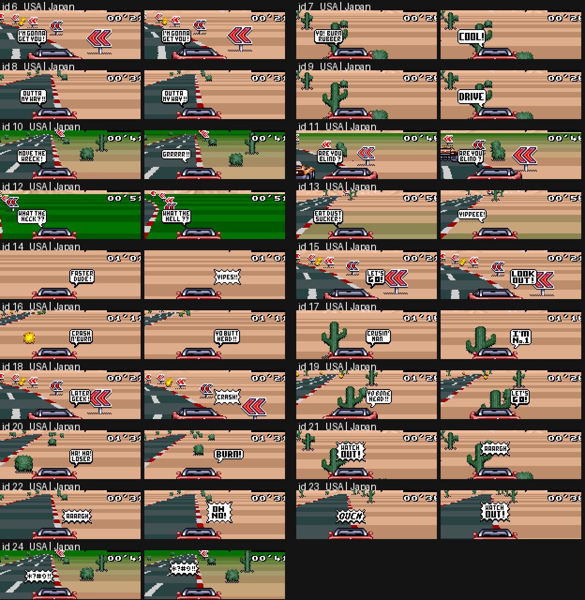

# Las tres versiones: Top Gear (USA), Top Gear (Europe), Top Racer (Japan)

Las tres son imágenes LoROM de 512 KB con el mismo layout, el mismo motor y los mismos datos de coches / pistas / música. Las diferencias son pequeñas y
caen en dos familias: **Europa = USA + un parche de temporización de 50 Hz**, **Japón = USA antes de la localización** (título distinto, textos de los globos,
dos contraseñas, sin anti-salto en el título). Todo lo siguiente se encontró comparando las ROM byte a byte, desensamblando cada una con su propia traza de
ejecución (`tools/disasm.py` + `tools/asmdiff.py`) y comprobando las conclusiones en el emulador (`scripts/ver_*.lua`).

| | USA | Europe | Japan |
|---|---|---|---|
| título de la cabecera / byte de país (`$7FD9`) / fabricante (`$7FDA`) | `TOP GEAR` / `01` / `7F` | `TOP GEAR` / `02` / `7F` | `TOP RACER` / `00` / `C2` |
| checksum de 16 bits (`$7FDE`) | `C15C` | `45BD` | `B79C` |
| código idéntico al USA (módulo reubicación) | - | sí, salvo los 3 parches de abajo | sí, salvo §Japón |
| tasa de cuadros | 60 Hz | 50 Hz, reloj del juego mantenido en 60 unidades/s | 60 Hz |

Estadísticas brutas de la diferencia: USA vs Europa 45 371 bytes difieren, USA vs Japón unos 118 000. Casi todo eso es ruido:
* **Las colas de los bancos son relleno sin inicializar.** El final sin usar de cada banco de 32 KB (y 0D:C9C2.., 0C:E962.., los primeros 0x2A0..0x400 bytes de los bancos 9..C) guarda
  bits aleatorios sobrantes en cada build (sobre todo `FF`/`00` con algunos bits sueltos). Nunca compares ahí.
* **Reubicación.** Europa inserta 21 + 22 bytes en el banco 00 (ver abajo), así que toda dirección del banco 00 posterior a `00:B6DC` se mueve +21 / +43 y todo
  puntero a ella cambia (`LDA $E1CE,X` -> `$E1F9,X`; 05:E50D, E59C, E6EC, E77B, F1E6, F6CE, F744, 0F:A8xx ...). Japón tiene +5 en el banco 00 después de 00:B751
  y +38 en el banco 0D a partir de aproximadamente `0D:C150` (tilemaps y cadenas de menú), -8 en el banco 0F después de `0F:8F2D`.
* **Streams comprimidos.** Los gráficos y la imagen del motor de 5 KB están comprimidos, así que un tile cambiado reescribe el resto de su stream.
  La imagen del motor en la WRAM descomprimida en el arranque (`7E2000-7E34FF`) es **idéntica byte a byte en USA y Europa**; el código en ella es el mismo en Japón
  (misma secuencia de instrucciones, valores de puntero distintos).
* Los inmediatos dentro de `7E2xxx..7E3xxx` difieren entre volcados tomados durante una carrera (p. ej. `LDA #$1B` vs `#$05` en 7E:26DF): son automodificados en tiempo de ejecución, no diferencias de la ROM.

## Europa (PAL, 50 Hz)

### El parche (3 sitios, todos en el banco 00)

El motor tiene dos bases de tiempo, ambas avanzadas por el trabajo por frame `irq_vblank_start` (00:B6D1, iniciado por el V-IRQ en la línea 224; la misma línea es la primera
línea de vblank en PAL, así que la configuración de IRQ/HDMA no necesitó cambios):

| contador | significado | usuarios |
|---|---|---|
| `$0C` | "frames transcurridos" | `wait_frames` (00:EC0E), y `$1E90 = $0C + 1` = el delta del tamaño del tick que escala distancia, rampas de RPM, persecución de velocidad ... |
| `$1EAE` | reloj de la carrera (`race_frames`) | cronómetro de vuelta/carrera, script de día/noche, tiempo de llegada |

Europa hace que ambos cuenten **6 unidades cada 5 frames** (= 60 unidades/s a 50 frames/s), de modo que todo lo expresado en tiempo de juego mantiene el ritmo NTSC:

```
00:B6DC (justo después de INC $0C)     00:B963 (justo después de INC $1EAE)
  SEP #$20                               SEP #$20
  LDA $18 / INC A / CMP #$05             LDA $19 / INC A / CMP #$05
  BNE +                                  BNE +
  STZ $18 ; REP #$20 ; INC $0C ; BRA ++  STZ $19 ; REP #$20 ; INC $1EAE ; BRA ++
+ STA $18 ; REP #$20                   + STA $19 ; REP #$20
++                                     ++
00:EC17 (bucle de espera de wait_frames)   BNE $EC15  ->  BMI $EC15   (el contador ahora puede saltarse el 0)
```
`$18`/`$19` empiezan como `$02/$02` (definido por `LDA #$0202 / STA $18` en 00:81D0) y no se usan para nada más en USA. (En Japón son `$8F/$00`, y `$19` se escribe en el registro de mosaico `$2106` en cada frame, ver abajo; el build USA eliminó esa escritura, Europa reutilizó el byte.)

Nada más en el código cambió: sin cambio de duración del VBlank, línea de IRQ, SETINI (`$2133 = 0`, 224 líneas) ni tempo de la música. Las 15 líneas extra de PAL
quedan simplemente en blanco, y el V-IRQ en 224 divide la pantalla exactamente como en NTSC.

### Lo que el parche *no* cubre (todo lo que sigue contándose en frames brutos)
El bucle principal está limitado por la CPU (~50 ms por tick, 20 ticks/s en ambos sistemas: USA 2,99 frames/tick, Europa 2,49 frames/tick = mismo tiempo),
así que los ticks de física, la quema de combustible, la persecución de velocidad y todo lo escalado por `$1E90` se comportan como en USA. Las cosas avanzadas **una vez por frame** no:

| cosa por frame | USA | Europe |
|---|---|---|
| **nitro** (máquina de estados 00:B9ED en el trabajo por frame, 320 frames, docs/02) | 5,33 s | **6,40 s** (384 unidades de tiempo de juego; medido con `scripts/ver_nitro.lua`: 320 frames en ambas ROM, `$1EAE` +320 vs +384) |
| **repostaje en el pit** (`00:9172`: `fuel += $7F` por pasada del bucle, una pasada por frame, ~339 pasadas, docs/04) | ~5,7 s | ~6,8 s (razonamiento sobre el código, no cronometrado) |
| pasos de destello de pantalla / fundido (`$E1`, `$E2`, `$52`, `$65`) | 16,7 ms por paso | 20 ms por paso |
| acumulación del scroll de curva (`$1E96 += $1E9A` -> `$B0`, `$1E98 += $1E9C` -> `$C4`, una vez por frame, 00:B9B7) | 60 pasos/s | 50 pasos/s (no medido) |
| cualquier cosa esperando en `wait_frames` | n unidades | n unidades (compensado, mismo tiempo real) |

### Combustible
Medido con `scripts/ver_fuel.lua` (hook en el código de quema 05:D638, acelerador a fondo, unos 1200 ticks de física por ROM, mismo script de entrada):

| | USA | Europe |
|---|---|---|
| quema por tick de física | 20,69 | 20,52 |
| frames por tick | 2,99 | 2,49 |
| unidades de tiempo de juego (`$1E90`) por tick | 2,978 | 2,977 |
| combustible por unidad de tiempo de juego (1/60 s) | 6,947 | 6,891 |
| combustible por distancia (`burn / sum(speed*delta)` x 1000) | 2,0851 | 2,0824 |

Así que, con conducción idéntica, el depósito se vacía al mismo ritmo por segundo real y por distancia; la diferencia es menor del 1 %, dentro del ruido de dos
historiales de carrera distintos. El código de quema es idéntico byte a byte, la quema es por tick, y la tasa de ticks en tiempo real es la misma. **No pude
reproducir un efecto de "menos combustible" en conducción en régimen constante.** Lo que sí difiere en Europa, y podría ser lo que siente la comunidad:
* el nitro dura un 20 % más (más tiempo a la alta velocidad máxima del nitro con la misma carga; la quema por distancia es casi igual, así que parece "el mismo combustible
  me lleva más lejos" en los tramos con nitro);
* un pit stop es ~1,1 s más largo, así que una estrategia que necesita menos paradas parece mejor;
* todo lo que dependa de la cuantización de frame/tick de `$1E90` (3 unidades vs la mezcla de 2/3 frames).
Si hay una afirmación concreta (qué coche, qué pista, cuántas vueltas por depósito) puede probarse directamente con el hook `ver_fuel`.

### Texto, gráficos, paleta (Europa)
* Ortografía: `TIRE GRIP` -> **`TYRE GRIP`** (cadenas de la selección de coche, 0F:A8A3 `49 -> 59`). La fuente de USA no tenía glifo `Y` en esa fuente, así que se añadió el glifo: los tiles 4bpp en el banco 02 (02:DD4C..DE38, E1ED..E2B8, E309.., EC4D..ED6E) y el stream de la fuente recomprimido en el banco 09 (09:D642..E573) difieren.
* Una paleta de 16 bytes en el banco 0E (0E:FBD6..FBE5) difiere. Son los colores 8..15 de la paleta de BG 2 en el conjunto de paletas grises de la foto del menú (CGRAM `$50..$5F`; los colores 0..7 son la rampa de grises
  `7FFF 7F7B 6EF7 5E73 3D6B 2CE7 1C63`). USA tiene `7210 71CE` x4 ahí, Europa ocho colores distintos. El conjunto lo lee la rutina de fundido en 0F:A245 en el logo de Kemco (frame ~806),
  el menú de opciones (~1546), la pantalla de ubicación (~1774) y la pantalla de resultados (~8545). Pintar los 8 colores de magenta en una copia de USA mostró **ningún píxel magenta en ninguna de esas pantallas**
  (los tiles solo usan la rampa de grises), y el mismo parche solo cambió el tiempo del fundido, así que esas entradas son relleno sin uso que difiere porque los datos del build difieren, no un cambio visible.
* Todo lo demás (título, menús, países, contraseñas, globos, resultados) es idéntico a USA. Las pantallas de título son iguales frame a frame.

## Japón (Top Racer)

### Igual que USA
Estadísticas de los coches y todas las tablas de física (`00:9597/960B/967F/96F3/97DB`, idénticas byte a byte en las mismas direcciones), el código de física / IA / colisión (el banco 05
difiere en 2 inmediatos + 8 punteros reubicados), descriptores y datos de las pistas (banco 0C), minimapas, datos de música/SPC (banco 07), renderizador de sprites (banco 01).
La física del juego, la quema de combustible, la duración del nitro (320 frames, probado) y las 32 pistas son las mismas que en USA.

### Diferencias
1. **Título:** `TOP RACER` con **tres** estrellas (USA/EUR: `TOP GEAR`, dos estrellas), y sin la línea `LICENSED BY NINTENDO`. Las cuentas del bucle de animación del logo difieren
   (`LDY #$0100`, `LDX #$0036` en lugar de `#$00E0`, `#$0045` en 0F:8ED0..8EDC). Texto final `ON COMPLETING TOP RACER`.
2. **Sin anti-salto en el título.** USA/EUR (0F:8F2D): `LDA $1FF6 / CMP #$03E8 / BCS` ignora Start durante los primeros 200 frames de la cuenta atrás de 1200 frames de la demo
   (`$1FF6` cuenta hacia abajo desde `$04B0`); Japón lo acepta de inmediato (los 8 bytes no están).
3. **Mosaico:** el trabajo por frame de Japón escribe `LDA $19 / STA $2106` (00:B751); `$19` nunca se define en el código, así que es permanentemente 0 (mosaico apagado). Resto de un efecto de transición que USA eliminó (la inicialización de USA `LDA #$0202 / STA $18` pone `$19 = 2`, inofensivo sin el store).
4. **Los globos de diálogo son distintos** (ver la tabla). El motor es el mismo; los 19 ids (6..24 -> `$0118`) muestran otros globos y las cuatro tablas aleatorias
   (`00:E1CA` roce, `E1CE` colisión, `E1DE` objeto lateral, `E1ED` colisiones repetidas) eligen otros ids, más dos inmediatos:
   inicio del nitro `LDA #$000F` -> `#$0013` (05:D376, DBF3, sigue siendo `LET'S GO!`) y doblar al otro jugador `LDA #$0013` -> `#$0010` (00:B369, B392).
5. **Contraseñas** (tabla `0D:C513`, que solo se *muestra*, nunca se pide): la palabra 9 `LEGEND` -> **`LEDGEND`** (errata, la contraseña del país 2 profesional) y la última
   (campeonato, último país) `KEELSON` -> **`VALHALLA`**. Las otras 19 son iguales.
6. **Cadenas:** `TYRE GRIP` (no `TIRE`), como en Europa. Créditos, tablas `= 8 PTS`, nombres de pistas sin cambios.
7. Gráficos / tilemaps en los bancos 02..04, 0D (tilemaps de menú, 0D:AEAF..C7F9) y 0E (tiles del logo del título) son distintos (logo nuevo, celdas de fuente nuevas);
   el banco 0F (menús) es el código de USA desplazado -8 bytes después de 0F:8F2D más cambios de punteros.

### Ids de los globos (Japón vs USA)


| id | USA | Japón | | id | USA | Japón |
|---|---|---|---|---|---|---|
| 6 | I'M GONNA GET YOU! | igual | | 16 | CRASH N' BURN | YO BUTT HEAD!! |
| 7 | YO! BURN RUBBER | COOL! | | 17 | CRUSIN' MAN | I'M No.1 |
| 8 | OUTTA MY WAY!! | igual | | 18 | LATER GEEK! | CRASH! |
| 9 | (nada) | DRIVE | | 19 | YO BONE HEAD!! | LET'S GO! |
| 10 | MOVE THE WRECK! | GRRRRR!! | | 20 | HA! HA! LOSER | BURN!! |
| 11 | ARE YOU BLIND? | igual | | 21 | WATCH OUT! | AAARGH |
| 12 | WHAT THE HECK?? | WHAT THE HELL?? | | 22 | AAARGH | OH NO! |
| 13 | EAT DUST SUCKER! | YIPPEEE! | | 23 | OUCH | WATCH OUT! |
| 14 | FASTER DUDE! | YIPES!! | | 24 | `&*#@!!` | igual |
| 15 | LET'S GO! | LOOK OUT! | | | | |

Qué ids dibuja el juego (docs/11 lista los disparadores de USA):

| disparador | ids de USA | ids de Japón |
|---|---|---|
| nitro pulsado por encima de 150 km/h | 15 LET'S GO! | 19 LET'S GO! |
| doblar al otro jugador | 19 YO BONE HEAD!! | 16 YO BUTT HEAD!! |
| roce a +180 km/h (`E1CA`, X = 0..3) | 7, 13, 20, 18 | 7 COOL!, 17 I'M No.1, 13 YIPPEEE!, 20 BURN!! |
| colisión a +180 km/h (`E1CE`, X = 12..15) | 8, 10, 11, 24 | 10 GRRRRR!!, 11 ARE YOU BLIND?, 14 YIPES!!, 24 |
| objeto lateral >= 140 km/h (`E1DE`, X = 0..3 (4 en Japón), 15) | 22, 23, 24, 21 / 10 | 21, 14, 23, 22, 15 / 8 |
| dos colisiones rápidas (`E1ED`, X = 0..4 repetidos) | 10, 11, 22, 12, 8 | 8, 6, 11, 24, 12 |

Ids sin uso: USA 6, 9, 14, 16, 17 (docs/11); Japón 9 (`DRIVE`) y 18 (`CRASH!`). El conjunto japonés es más "amigable" (los insultos de USA `EAT DUST SUCKER!`, `HA! HA! LOSER`, `LATER GEEK!` han desaparecido) y encaja mejor con el evento (`YIPPEEE!`
tras un adelantamiento, `OH NO!` / `CRASH!` tras un golpe).

## Cómo se hizo / reproducir
1. `python3 -I tools/romcmp.py "Top Gear (USA).sfc" "Top Gear (Europe).sfc"`: campos de la cabecera, mapa de similitud de 4 KB, regiones distintas (ojo con el ruido de relleno y reubicación descrito al principio).
2. Para cada ROM: `TG_ROM=<rom> tools/mesen.sh scripts/trace.lua` (traza de cobertura, equivalente a `out/trace_main.txt`), `scripts/dumpram.lua` (WRAM en el frame 3300), luego
   `python3 -I tools/disasm.py ROM out.asm --seeds trace --wram wram_3300.bin`.
3. `python3 -I tools/asmdiff.py usa.asm eur.asm` lista solo los cambios reales (los destinos de salto y los operandos de 16 bits se enmascaran; `--all` muestra también las reubicaciones).
   USA vs Europa imprime exactamente los tres parches de arriba; USA vs Japón imprime la lista de §Japón.
4. Comprobaciones en el emulador: `scripts/ver_nitro.lua`, `scripts/ver_fuel.lua`, `scripts/ver_balloons.lua` (todos aceptan `TG_ROM`).
