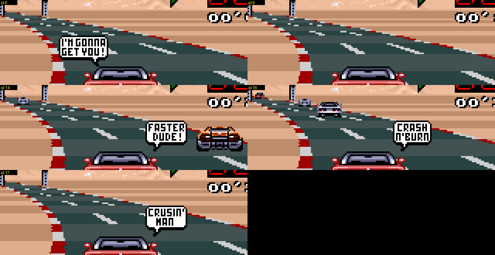

# Mensagens de corrida e balões de fala (jogo original)

Dois tipos de pop-up aparecem sobre a visão de cada jogador durante a corrida. Os dois passam pela mesma máquina de estados em `update_hud_counters` (`00:DA75`) e são escritos no tilemap do BG1 com `hud_draw_string_p1/p2` (`00:DD9C/DDC0`, tabela de strings `06:DF16`, 130 entradas). Achado lendo o disassembly e confirmado no Mesen forçando as variáveis de estado e jogando (os scripts foram descartáveis; as tabelas abaixo são lidas direto da ROM).

* **Mensagens de texto** (fonte de pixels branca, piscam): mudança de posição (`13TH`), voltas restantes, `FUEL LOW`, `OUT OF FUEL`, contagem regressiva, `RACE OVER`, seta do pit.
* **Balões de fala** (balão branco com rabinho e comentário estilo quadrinhos): os que você nota ao ultrapassar, bater ou dar volta em alguém.

## Variáveis de estado

| | P1 | P2 / carro do computador | significado |
|---|---|---|---|
| `$0118` / `$012A` | | | **pedido de balão**, 0 = nenhum. Escrito pela lógica do jogo, consumido pelo código do HUD (`00:DB75` / `DD07`) e zerado. Índice da mensagem = id + `$1E` (P1) ou id + `$5D` (P2). |
| `$0124` / `$0136` | | | índice da mensagem atual (número da string em `06:DF16`), `$FFFF` = nenhuma |
| `$0126` / `$0138` | | | contador de piscada/fase da mensagem (período de 6 frames) |
| `$0128` / `$013A` | | | flags copiadas da tabela `06:DB80[index]`: `$8000` pisca, `$4000` / `$C000` fica até ser substituída |
| `$0120` / `$0132` | | | ponteiro para um stream de gráficos (`06:DC84[index]`): `pit_sign_dma` (`00:D86A`) copia 64 bytes (2 tiles) por frame para a VRAM (`$0122` / `$0134`, +`$20` palavras a cada passo) até um terminador 0, de modo que o texto ou a arte do balão é "digitado" ao longo de alguns frames antes de o tilemap ser mostrado |
| `$011A` / `$012C` | | | última posição mostrada |
| `$011E` / `$0130` | | | última contagem de voltas mostrada |
| `$011C` / `$012E` | | | estado do aviso de combustível |
| `$1EFB` / `$1EFC` | | | **calor de colisão** (byte): +`$30` por contato entre carros, -1 por frame |
| `$1EF5` bit1 / `$1EF6` bit1 | | | trava "já provocou por esta volta dada" |

Mapa de índices de mensagem (P1; P2 é a mesma lista em +`$3F`, então as posições de P2 começam em 63):

| índice | texto | gatilho |
|---|---|---|
| 0..19 | posição `1ST`..`20TH` | `$1E7A` (posição, base 0) difere da última mostrada |
| 20 | `FINAL LAP` | o contador de voltas muda, `laps_total - 1 - done = 0` |
| 21..28 | `2 LAPS LEFT` .. `9 LAPS LEFT` | idem, índice = 20 + voltas restantes depois da atual |
| 29 | `FUEL LOW` | combustível `$1E62 < $3000` (uma vez; rearmado quando o combustível volta acima de `$3000`) |
| 30 | `OUT OF FUEL` | combustível = 0 (permanece) |
| 31..34 | `3`, `2`, `1`, `GO!` | contagem da largada: `$0118` = 1..4 em `00:868A` |
| 35 | `RACE OVER` | o carro terminou: `$0118` = 5 em `00:8790` (permanece; a string da posição final vem depois) |
| 36..54 | balões de fala, id 6..24 | veja abaixo |
| 55..62 | faixas largas de texto (bandeira 4000, stream de gráficos compartilhado `050E`) | nenhum escritor achado na lógica; provavelmente sobras sem uso |
| 126 / 127 | seta do pit (esquerda / direita, da flag de lado da placa `$DF`) | o carro está a até `$1000` unidades antes da entrada da pit lane (`$1EF0`) |

Quando uma volta é completada e a corrida não acabou, a mensagem da volta entra na fila no lugar da mensagem de posição; posição, combustível e pit só são verificados quando nenhuma outra mensagem está na tela (`$0128 = 0`).

## Ids dos balões de fala

Verificado forçando `$0118` numa corrida (índice = id + 30):

| id | texto | id | texto |
|---|---|---|---|
| 6 | I'M GONNA GET YOU! | 16 | CRASH N' BURN |
| 7 | YO! BURN RUBBER | 17 | CRUSIN' MAN |
| 8 | OUTTA MY WAY!! | 18 | LATER GEEK! |
| 9 | (gráficos vazios) | 19 | YO BONE HEAD!! |
| 10 | MOVE THE WRECK! | 20 | HA! HA! LOSER |
| 11 | ARE YOU BLIND? | 21 | WATCH OUT! |
| 12 | WHAT THE HECK?? | 22 | AAARGH |
| 13 | EAT DUST SUCKER! | 23 | OUCH |
| 14 | FASTER DUDE! | 24 | &*#@!! (xingamento) |
| 15 | LET'S GO! | | |

Os ids 6, 9, 14, 16 e 17 nunca são produzidos por nenhum dos gatilhos abaixo. São conteúdo que sobrou: 6, 14, 16 e 17 são balões completos de aparência normal (`I'M GONNA GET YOU!`, `FASTER DUDE!`, `CRASH N'BURN`, `CRUSIN' MAN`), e o id 9 não mostra nada (seu tilemap é desenhado, mas nenhuma arte de balão apareceu em momento algum da janela de exibição; o stream de gráficos `06:DE1A` não foi inspecionado).

Cada balão aparece num ponto fixo da visão do jogador (meio superior, acima do carro); os carros ao lado na imagem são só bots passando. A imagem é um recorte 4x por vizinho mais próximo de frames do jogo (ordem: 6, 9 / 14, 16 / 17).

## O que dispara um balão

Todos os gatilhos escrevem o id em `$0118` (P1) ou `$012A` (P2 / carro do computador). O balão é sempre o comentário do *próprio carro*, mostrado na visão daquele jogador. O P2 usa o código espelhado (`05:E6xx/E7xx`, `05:DBF6`) com as variáveis do P2; numa corrida de 1 jogador o lado "P2" é o carro do computador e seus balões nunca são desenhados.

1. **Nitro** (`05:D379`, P2: `05:DBF6`): apertar o botão de nitro com uma carga sobrando e velocidade `$1E5A >= $1900` (150 km/h) diz o id **15** `LET'S GO!` (sempre, sem sorteio).
2. **Ultrapassar um carro com grande vantagem de velocidade** (`05:E3D6`..`E5A4`; P2 `05:E6xx`..`E789`): a cada tick o código olha o carro mais próximo à frente na lista. Quando a posição do jogador o alcança (a até 7 unidades) e o jogador é mais rápido, e a diferença de velocidade `player - car*2` excede `$1E00` (7680 = 180 km/h), um número aleatório `X = rng >> 4` (0..15) escolhe o comentário numa tabela, então cada evento qualificado tem 4/16 de chance de balão (as outras 12 entradas são 0):
   * distância lateral dentro da janela de acerto (uma **colisão** de verdade): `00:E1CE[X]`, só X = 12..15 dão balão: ids **8, 10, 11, 24** (`OUTTA MY WAY!!`, `MOVE THE WRECK!`, `ARE YOU BLIND?`, `&*#@!!`).
   * distância lateral maior que a janela (uma **raspada de raspão**, o carro passa ao seu lado): `00:E1CA[X]`, X = 0..3: ids **7, 13, 20, 18** (`YO! BURN RUBBER`, `EAT DUST SUCKER!`, `HA! HA! LOSER`, `LATER GEEK!`).
   Como `X` vem do LCG compartilhado, cada evento também avança a sequência aleatória (veja as notas de RNG em docs/03).
3. **Várias colisões seguidas** (`00:B33B` `bots_event_counters`, chamado a cada tick de `00:8770`): toda colisão do caso 2 soma `$30` ao byte de calor `$1EFB` (P1) / `$1EFC` (P2), tenha dado balão ou não; o byte decai 1 por tick. Quando chega a `>= $50` (dois contatos em cerca de 16 ticks) ele é zerado e um balão é sorteado de `00:E1ED[X]`: ids **10, 11, 22, 12, 8** (X = 5 não dá nada), ou seja `MOVE THE WRECK!`, `ARE YOU BLIND?`, `AAARGH`, `WHAT THE HECK??`, `OUTTA MY WAY!!`.
4. **Bater forte num objeto lateral** (`05:F6B3`, objetos da classe REV, veja docs/03): quando a velocidade `>= $1770` (cerca de 140 km/h) no impacto, `00:E1DE[X]` dá os ids **22, 23, 24, 21** para X = 0..3 (`AAARGH`, `OUCH`, `&*#@!!`, `WATCH OUT!`), e o id 10 para X = 15. Mesma chance de 4/16.
5. **Dar volta no outro jogador** (`00:B33B`): os contadores de volta dos dois jogadores são comparados (`$1E76 - $1E78`, ambos incrementados antes para que o valor "antes da linha de largada" `$FFFF` conte como 0). Se o jogador 1 está à frente por 2 ou mais voltas, ou por exatamente 1 volta *e* também à frente na pista (`$0204 >= $0206`, offsets de slot na lista de carros), o líder recebe o id **19** `YO BONE HEAD!!` uma vez (travado no bit1 de `$1EF5`; a trava é limpa quando o outro jogador está na frente ou as voltas são iguais, então rearma depois que o jogador dobrado volta à mesma volta). O jogador 2 recebe o mesmo por `$1EF6` / `$012A`. Numa corrida de 1 jogador `$1E78` é a contagem de voltas do carro do computador, então o humano recebe a provocação ao dobrar o computador e o balão do computador fica escondido.

Não encontrado: nenhum balão está ligado a ser batido por trás por um bot (`00:A30C`) ou a sair da pista; isso só liga a flag do som de batida.

## Notas para o randomizer

Nada no hack toca nessas tabelas nem na máquina de estados. As mensagens são desenhadas nas linhas 4-8 do tilemap do BG1 (P1, strings em `$0C8B`..`$0D12`) e nas linhas 18-22 (P2, `$0E4E`..`$0ED2`), na maior parte nas colunas 11-21. Os contadores de volta ficam nas linhas 5 e 19 a partir da coluna 21 (alinhados à direita na coluna 29), então só as mensagens mais largas podem tocar a primeira célula do contador; não conferido na GUI.
