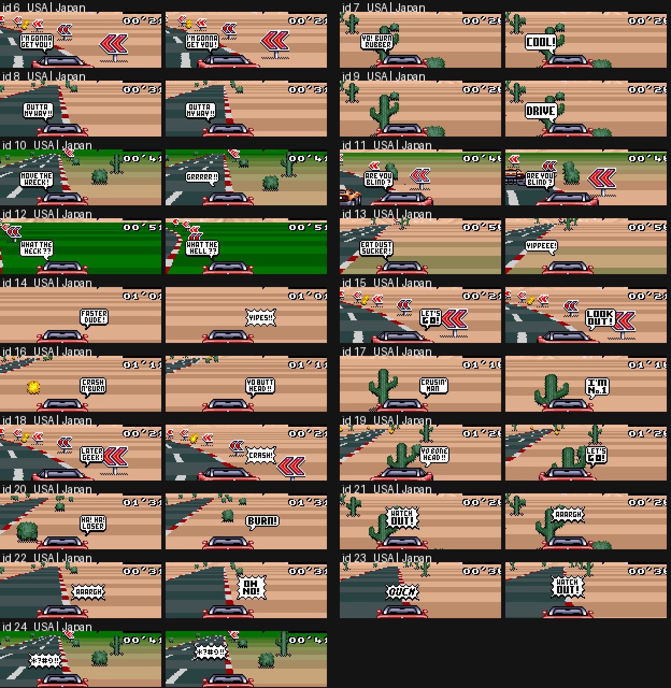

# As três versões: Top Gear (USA), Top Gear (Europe), Top Racer (Japan)

As três são imagens LoROM de 512 KB com o mesmo layout, o mesmo motor e os mesmos dados de carros / pistas / música. As diferenças são pequenas e
caem em duas famílias: **Europa = USA + um patch de temporização de 50 Hz**, **Japão = USA antes da localização** (título diferente, textos dos balões,
duas senhas, sem anti-skip no título). Tudo abaixo foi encontrado comparando as ROMs byte a byte, desmontando cada uma com seu próprio trace de
execução (`tools/disasm.py` + `tools/asmdiff.py`) e conferindo as conclusões no emulador (`scripts/ver_*.lua`).

| | USA | Europe | Japan |
|---|---|---|---|
| título no header / byte de país (`$7FD9`) / fabricante (`$7FDA`) | `TOP GEAR` / `01` / `7F` | `TOP GEAR` / `02` / `7F` | `TOP RACER` / `00` / `C2` |
| checksum de 16 bits (`$7FDE`) | `C15C` | `45BD` | `B79C` |
| código idêntico ao USA (módulo relocação) | - | sim, exceto os 3 patches abaixo | sim, exceto §Japão |
| taxa de quadros | 60 Hz | 50 Hz, relógio do jogo mantido em 60 unidades/s | 60 Hz |

Estatísticas brutas da diferença: USA vs Europa 45 371 bytes diferem, USA vs Japão cerca de 118 000. Quase tudo isso é ruído:
* **As pontas dos bancos são padding não inicializado.** O fim não usado de cada banco de 32 KB (e 0D:C9C2.., 0C:E962.., os primeiros 0x2A0..0x400 bytes dos bancos 9..C) guarda
  bits aleatórios sobrando em cada build (principalmente `FF`/`00` com alguns bits soltos). Nunca compare ali.
* **Relocação.** A Europa insere 21 + 22 bytes no banco 00 (veja abaixo), então todo endereço do banco 00 depois de `00:B6DC` se move +21 / +43 e todo
  ponteiro para ele muda (`LDA $E1CE,X` -> `$E1F9,X`; 05:E50D, E59C, E6EC, E77B, F1E6, F6CE, F744, 0F:A8xx ...). O Japão tem +5 no banco 00 depois de 00:B751
  e +38 no banco 0D a partir de cerca de `0D:C150` (tilemaps e strings de menu), -8 no banco 0F depois de `0F:8F2D`.
* **Streams comprimidos.** Os gráficos e a imagem do motor de 5 KB são comprimidos, então um tile alterado reescreve o resto do seu stream.
  A imagem do motor na WRAM descomprimida no boot (`7E2000-7E34FF`) é **idêntica byte a byte no USA e na Europa**; o código nela é o mesmo no Japão
  (mesma sequência de instruções, valores de ponteiro diferentes).
* Imediatos dentro de `7E2xxx..7E3xxx` diferem entre dumps tirados durante uma corrida (p. ex. `LDA #$1B` vs `#$05` em 7E:26DF): são automodificados em tempo de execução, não diferenças da ROM.

## Europa (PAL, 50 Hz)

### O patch (3 lugares, todos no banco 00)

O motor tem duas bases de tempo, ambas avançadas pelo job por frame `irq_vblank_start` (00:B6D1, iniciado pelo V-IRQ na linha 224; a mesma linha é a primeira
linha de vblank no PAL, então a configuração de IRQ/HDMA não precisou mudar):

| contador | significado | usuários |
|---|---|---|
| `$0C` | "frames decorridos" | `wait_frames` (00:EC0E), e `$1E90 = $0C + 1` = o delta do tamanho do tick que escala distância, rampas de RPM, perseguição de velocidade ... |
| `$1EAE` | relógio da corrida (`race_frames`) | cronômetro de volta/corrida, script de dia/noite, tempo de chegada |

A Europa faz os dois contarem **6 unidades a cada 5 frames** (= 60 unidades/s a 50 frames/s), de modo que tudo que é expresso em tempo de jogo mantém o ritmo NTSC:

```
00:B6DC (logo após INC $0C)            00:B963 (logo após INC $1EAE)
  SEP #$20                               SEP #$20
  LDA $18 / INC A / CMP #$05             LDA $19 / INC A / CMP #$05
  BNE +                                  BNE +
  STZ $18 ; REP #$20 ; INC $0C ; BRA ++  STZ $19 ; REP #$20 ; INC $1EAE ; BRA ++
+ STA $18 ; REP #$20                   + STA $19 ; REP #$20
++                                     ++
00:EC17 (laço de espera de wait_frames)   BNE $EC15  ->  BMI $EC15   (o contador agora pode pular o 0)
```
`$18`/`$19` começam como `$02/$02` (definido por `LDA #$0202 / STA $18` em 00:81D0) e não são usados para mais nada no USA. (No Japão são `$8F/$00`, e `$19` é escrito no registrador de mosaico `$2106` a cada frame, veja abaixo; o build USA removeu essa escrita, a Europa reaproveitou o byte.)

Nada mais no código mudou: sem mudança de duração do VBlank, linha de IRQ, SETINI (`$2133 = 0`, 224 linhas) ou andamento da música. As 15 linhas extras do PAL
ficam simplesmente em branco, e o V-IRQ em 224 divide a tela exatamente como no NTSC.

### O que o patch *não* cobre (tudo ainda contado em frames brutos)
O laço principal é limitado pela CPU (~50 ms por tick, 20 ticks/s nos dois sistemas: USA 2,99 frames/tick, Europa 2,49 frames/tick = mesmo tempo),
então ticks de física, queima de combustível, perseguição de velocidade e tudo escalado por `$1E90` se comportam como no USA. Coisas avançadas **uma vez por frame** não:

| coisa por frame | USA | Europe |
|---|---|---|
| **nitro** (máquina de estados 00:B9ED no job por frame, 320 frames, docs/02) | 5,33 s | **6,40 s** (384 unidades de tempo de jogo; medido com `scripts/ver_nitro.lua`: 320 frames nas duas ROMs, `$1EAE` +320 vs +384) |
| **reabastecimento no pit** (`00:9172`: `fuel += $7F` por passagem do laço, uma passagem por frame, ~339 passagens, docs/04) | ~5,7 s | ~6,8 s (raciocínio sobre o código, não cronometrado) |
| passos de flash de tela / fade (`$E1`, `$E2`, `$52`, `$65`) | 16,7 ms por passo | 20 ms por passo |
| acumulação do scroll de curva (`$1E96 += $1E9A` -> `$B0`, `$1E98 += $1E9C` -> `$C4`, uma vez por frame, 00:B9B7) | 60 passos/s | 50 passos/s (não medido) |
| qualquer coisa esperando em `wait_frames` | n unidades | n unidades (compensado, mesmo tempo real) |

### Combustível
Medido com `scripts/ver_fuel.lua` (hook no código de queima 05:D638, acelerador a fundo, cerca de 1200 ticks de física por ROM, mesmo script de entrada):

| | USA | Europe |
|---|---|---|
| queima por tick de física | 20,69 | 20,52 |
| frames por tick | 2,99 | 2,49 |
| unidades de tempo de jogo (`$1E90`) por tick | 2,978 | 2,977 |
| combustível por unidade de tempo de jogo (1/60 s) | 6,947 | 6,891 |
| combustível por distância (`burn / sum(speed*delta)` x 1000) | 2,0851 | 2,0824 |

Então, com direção idêntica, o tanque esvazia na mesma taxa por segundo real e por distância; a diferença é menor que 1 %, dentro do ruído de dois
históricos de corrida diferentes. O código de queima é idêntico byte a byte, a queima é por tick, e a taxa de ticks em tempo real é a mesma. **Não consegui
reproduzir um efeito de "menos combustível" em direção em regime constante.** O que difere na Europa, e poderia ser o que a comunidade sente:
* o nitro dura 20 % mais (mais tempo na velocidade máxima alta do nitro com a mesma carga; a queima por distância é praticamente igual, então isso parece "o mesmo combustível
  me leva mais longe" nos trechos de nitro);
* um pit stop é ~1,1 s mais longo, então uma estratégia que precisa de menos paradas parece melhor;
* qualquer coisa que dependa da quantização de frame/tick de `$1E90` (3 unidades vs a mistura de 2/3 frames).
Se houver uma alegação concreta (qual carro, qual pista, quantas voltas por tanque) ela pode ser testada diretamente com o hook `ver_fuel`.

### Texto, gráficos, paleta (Europa)
* Ortografia: `TIRE GRIP` -> **`TYRE GRIP`** (strings da seleção de carro, 0F:A8A3 `49 -> 59`). A fonte do USA não tinha glifo `Y` nessa fonte, então o glifo foi adicionado: os tiles 4bpp no banco 02 (02:DD4C..DE38, E1ED..E2B8, E309.., EC4D..ED6E) e o stream da fonte recomprimido no banco 09 (09:D642..E573) diferem.
* Uma paleta de 16 bytes no banco 0E (0E:FBD6..FBE5) difere. São as cores 8..15 da paleta de BG 2 no conjunto de paletas cinza da foto do menu (CGRAM `$50..$5F`; as cores 0..7 são a rampa de cinza
  `7FFF 7F7B 6EF7 5E73 3D6B 2CE7 1C63`). O USA tem `7210 71CE` x4 ali, a Europa oito cores diferentes. O conjunto é lido pela rotina de fade em 0F:A245 no logo da Kemco (frame ~806),
  no menu de opções (~1546), na tela de localização (~1774) e na tela de resultados (~8545). Pintar as 8 cores de magenta numa cópia do USA mostrou **nenhum pixel magenta em nenhuma dessas telas**
  (os tiles só usam a rampa de cinza), e o mesmo patch só mudou o timing do fade, então essas entradas são enchimento sem uso que difere porque os dados do build diferem, não uma mudança visível.
* Todo o resto (título, menus, países, senhas, balões, resultados) é idêntico ao USA. As telas de título são iguais frame a frame.

## Japão (Top Racer)

### Igual ao USA
Estatísticas dos carros e todas as tabelas de física (`00:9597/960B/967F/96F3/97DB`, idênticas byte a byte nos mesmos endereços), o código de física / IA / colisão (o banco 05
difere em 2 imediatos + 8 ponteiros relocados), descritores e dados das pistas (banco 0C), minimapas, dados de música/SPC (banco 07), renderizador de sprites (banco 01).
A física do jogo, a queima de combustível, a duração do nitro (320 frames, testado) e as 32 pistas são as mesmas do USA.

### Diferenças
1. **Título:** `TOP RACER` com **três** estrelas (USA/EUR: `TOP GEAR`, duas estrelas), e sem a linha `LICENSED BY NINTENDO`. As contagens do laço de animação do logo diferem
   (`LDY #$0100`, `LDX #$0036` em vez de `#$00E0`, `#$0045` em 0F:8ED0..8EDC). Texto final `ON COMPLETING TOP RACER`.
2. **Sem anti-skip no título.** USA/EUR (0F:8F2D): `LDA $1FF6 / CMP #$03E8 / BCS` ignora o Start durante os primeiros 200 frames da contagem regressiva de 1200 frames da demo
   (`$1FF6` conta para baixo a partir de `$04B0`); o Japão o aceita imediatamente (os 8 bytes não estão lá).
3. **Mosaico:** o job por frame do Japão escreve `LDA $19 / STA $2106` (00:B751); `$19` nunca é definido no código, então é permanentemente 0 (mosaico desligado). Sobra de um efeito de transição que o USA removeu (a inicialização do USA `LDA #$0202 / STA $18` põe `$19 = 2`, inofensivo sem o store).
4. **Os balões de fala são diferentes** (veja a tabela). O motor é o mesmo; os 19 ids (6..24 -> `$0118`) mostram outros balões e as quatro tabelas aleatórias
   (`00:E1CA` raspão, `E1CE` colisão, `E1DE` objeto lateral, `E1ED` colisões repetidas) escolhem outros ids, mais dois imediatos:
   início do nitro `LDA #$000F` -> `#$0013` (05:D376, DBF3, continua `LET'S GO!`) e dar volta no outro jogador `LDA #$0013` -> `#$0010` (00:B369, B392).
5. **Senhas** (tabela `0D:C513`, que só é *mostrada*, nunca pedida): a palavra 9 `LEGEND` -> **`LEDGEND`** (erro de digitação, a senha do país 2 profissional) e a última
   (campeonato, último país) `KEELSON` -> **`VALHALLA`**. As outras 19 são iguais.
6. **Strings:** `TYRE GRIP` (não `TIRE`), como na Europa. Créditos, tabelas `= 8 PTS`, nomes de pistas inalterados.
7. Gráficos / tilemaps nos bancos 02..04, 0D (tilemaps de menu, 0D:AEAF..C7F9) e 0E (tiles do logo do título) são diferentes (logo novo, células de fonte novas);
   o banco 0F (menus) é o código do USA deslocado -8 bytes depois de 0F:8F2D mais mudanças de ponteiros.

### Ids dos balões (Japão vs USA)


| id | USA | Japão | | id | USA | Japão |
|---|---|---|---|---|---|---|
| 6 | I'M GONNA GET YOU! | igual | | 16 | CRASH N' BURN | YO BUTT HEAD!! |
| 7 | YO! BURN RUBBER | COOL! | | 17 | CRUSIN' MAN | I'M No.1 |
| 8 | OUTTA MY WAY!! | igual | | 18 | LATER GEEK! | CRASH! |
| 9 | (nada) | DRIVE | | 19 | YO BONE HEAD!! | LET'S GO! |
| 10 | MOVE THE WRECK! | GRRRRR!! | | 20 | HA! HA! LOSER | BURN!! |
| 11 | ARE YOU BLIND? | igual | | 21 | WATCH OUT! | AAARGH |
| 12 | WHAT THE HECK?? | WHAT THE HELL?? | | 22 | AAARGH | OH NO! |
| 13 | EAT DUST SUCKER! | YIPPEEE! | | 23 | OUCH | WATCH OUT! |
| 14 | FASTER DUDE! | YIPES!! | | 24 | `&*#@!!` | igual |
| 15 | LET'S GO! | LOOK OUT! | | | | |

Quais ids o jogo desenha (docs/11 lista os gatilhos do USA):

| gatilho | ids do USA | ids do Japão |
|---|---|---|
| nitro apertado acima de 150 km/h | 15 LET'S GO! | 19 LET'S GO! |
| dar volta no outro jogador | 19 YO BONE HEAD!! | 16 YO BUTT HEAD!! |
| raspão a +180 km/h (`E1CA`, X = 0..3) | 7, 13, 20, 18 | 7 COOL!, 17 I'M No.1, 13 YIPPEEE!, 20 BURN!! |
| colisão a +180 km/h (`E1CE`, X = 12..15) | 8, 10, 11, 24 | 10 GRRRRR!!, 11 ARE YOU BLIND?, 14 YIPES!!, 24 |
| objeto lateral >= 140 km/h (`E1DE`, X = 0..3 (4 no Japão), 15) | 22, 23, 24, 21 / 10 | 21, 14, 23, 22, 15 / 8 |
| duas colisões rápidas (`E1ED`, X = 0..4 repetidos) | 10, 11, 22, 12, 8 | 8, 6, 11, 24, 12 |

Ids sem uso: USA 6, 9, 14, 16, 17 (docs/11); Japão 9 (`DRIVE`) e 18 (`CRASH!`). O conjunto japonês é mais "amigável" (os insultos do USA `EAT DUST SUCKER!`, `HA! HA! LOSER`, `LATER GEEK!` sumiram) e combina melhor com o evento (`YIPPEEE!`
depois de uma ultrapassagem, `OH NO!` / `CRASH!` depois de uma batida).

## Como foi feito / reproduzir
1. `python3 -I tools/romcmp.py "Top Gear (USA).sfc" "Top Gear (Europe).sfc"`: campos do header, mapa de similaridade de 4 KB, regiões diferentes (atenção ao ruído de padding e relocação descrito no início).
2. Para cada ROM: `TG_ROM=<rom> tools/mesen.sh scripts/trace.lua` (trace de cobertura, equivalente a `out/trace_main.txt`), `scripts/dumpram.lua` (WRAM no frame 3300), depois
   `python3 -I tools/disasm.py ROM out.asm --seeds trace --wram wram_3300.bin`.
3. `python3 -I tools/asmdiff.py usa.asm eur.asm` lista só as mudanças reais (alvos de salto e operandos de 16 bits são mascarados; `--all` mostra também as relocações).
   USA vs Europa imprime exatamente os três patches acima; USA vs Japão imprime a lista de §Japão.
4. Verificações no emulador: `scripts/ver_nitro.lua`, `scripts/ver_fuel.lua`, `scripts/ver_balloons.lua` (todos aceitam `TG_ROM`).
